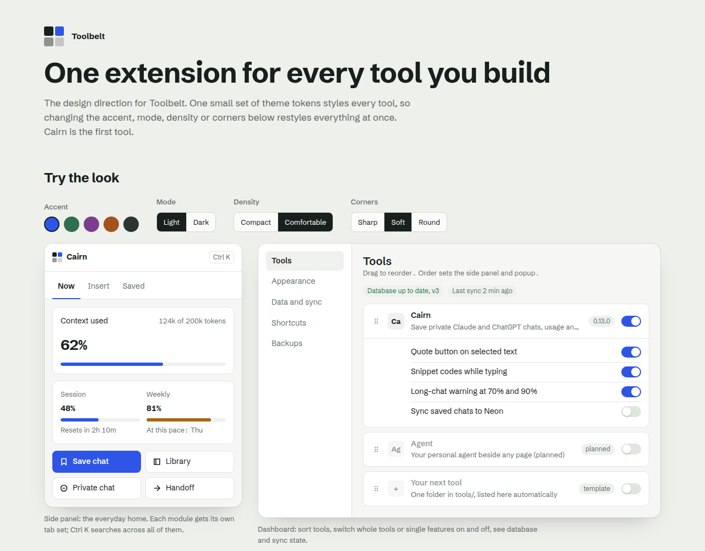

<div align="center">

# Toolbelt

**Your own browser tools, in one extension.**
Build a tool once. Run it inside Toolbelt, or ship it as its own extension.

[](https://github.com/alihassan-coder/dailykit-chrome-extension/actions/workflows/ci.yml)
[](LICENSE)




</div>

## Why Toolbelt

Most people end up with a dozen small extensions, each with its own icon, settings and permissions. Toolbelt is one place for the tools you build yourself:

- **One home.** Every tool lives in the side panel. Sort them, switch them on and off, or turn off single features.
- **Ask for access only when needed.** A tool requests its sites when you switch it on, never all at install.
- **Ship any tool alone.** The same code builds as a standalone extension, ready for the Chrome Web Store.
- **Your data stays yours.** Local first. Optional sync to your own Neon Postgres, end-to-end encrypted with your master password.
- **One look everywhere.** A single set of theme tokens styles every tool: accent, light or dark, density, corners.

## Tools

| Tool      | What it does                                                                                     | Status         |
| --------- | ------------------------------------------------------------------------------------------------ | -------------- |
| **Cairn** | Save private Claude and ChatGPT chats, search them later, see context size and usage as you type | In development |
| Agent     | A personal AI agent beside any page                                                              | Planned        |

## Try it in Chrome

```bash
pnpm install
pnpm build
```

1. Open `chrome://extensions` and switch on **Developer mode** (top right).
2. Click **Load unpacked** and pick a folder:

   | To test              | Folder                             |
   | -------------------- | ---------------------------------- |
   | Cairn on its own     | `apps/cairn/.output/chrome-mv3`    |
   | Toolbelt (all tools) | `apps/toolbelt/.output/chrome-mv3` |

3. Open [claude.ai](https://claude.ai). With **Cairn**, a _Save chat_ chip appears at the bottom right.
   With **Toolbelt**, first allow the site: Toolbelt → **Details** → **Site access** → add `https://claude.ai`, then reload the tab.

After you change code, run `pnpm build` again and press the reload icon on the extension card.

## Connect your Claude subscription

1. With Claude Code installed, run `claude setup-token` in your terminal and sign in with your Claude account.
2. Open the Toolbelt dashboard → **AI providers** → **Anthropic**. Choose **Claude subscription (setup token)**.
3. Paste the complete token starting with `sk-ant-oat01-` and click **Save token**.
4. Click **Test connection** to send a small Claude request using your account allowance, then choose a Claude model in the agent or Profile Lens.

The setup token uses bearer authentication through the shared Claude adapter. Existing API keys still work;
switch the Anthropic connection method to **API key** to use API billing. The extension stores one Anthropic
credential at a time. Credentials stay in browser local storage unless you enable encrypted account sync.

Subscription limits and model access depend on your Anthropic account. Setup tokens have no refresh token;
if one expires or is revoked, run `claude setup-token` again and use **Replace token**. The connection test
reports authentication and usage-limit failures without exposing the token. Model discovery can fail for a
token with inference-only access; the model picker then offers the built-in Claude fallback list.

Memory can use the Claude token for fact extraction, but still requires an OpenAI or Gemini API key for
embeddings. The extension cannot launch or automatically read a local Claude Code login.

Protocol references: [OpenClaw setup-token authentication](https://docs.openclaw.ai/gateway/authentication)
and [pi's Claude adapter](https://github.com/earendil-works/pi/blob/main/packages/ai/src/api/anthropic-messages.ts).

## Develop

Requires **Node 24** and **pnpm 12**, on a Linux filesystem such as ext4 (pnpm needs symlinks).

| Command              | Does                                                             |
| -------------------- | ---------------------------------------------------------------- |
| `pnpm dev`           | Toolbelt with live reload                                        |
| `pnpm dev:cairn`     | Cairn standalone with live reload                                |
| `pnpm check`         | Lint, format, types, tests and builds. Run before every push.    |
| `pnpm build`         | Chrome builds in `apps/*/.output/chrome-mv3`                     |
| `pnpm build:firefox` | Firefox builds in `apps/*/.output/firefox-mv3`                   |
| `pnpm zip`           | Store-ready zips                                                 |
| `pnpm test`          | Unit tests                                                       |
| `pnpm e2e`           | Real-browser tests (set `CHROME` to a Chrome for Testing binary) |

## How it is built

```
apps/        one folder per product that ships (toolbelt, cairn)
tools/       one package per tool: its description, page scripts and screens
packages/
  core/      the tool contract and runtime script registration
  ui/        theme tokens and shared components
  db/        local storage and Neon sync
  wxt-kit/   turns each tool's description into manifests and entrypoints
docs/        research, design and decisions
```

A few rules keep it maintainable as it grows, and the linter enforces them: tools never import each other, only the background touches the database, and code that runs inside web pages never sees extension APIs. Read [ARCHITECTURE.md](ARCHITECTURE.md) for the full picture.

**Stack:** [WXT](https://wxt.dev) · TypeScript · React · Tailwind CSS v4 · Radix UI · Vitest · Neon Postgres

## Roadmap

- [x] Workspace, build pipeline, bundle and standalone builds
- [x] Architecture rules enforced by lint, CI
- [ ] Core: settings, storage, migrations, theme engine
- [ ] Side panel, dashboard and command palette
- [ ] Cairn: full port with a new interface
- [ ] Accounts and encrypted Neon sync
- [ ] Cairn on the Chrome Web Store

## Privacy

Nothing leaves your device unless you switch on sync. Sync goes to a Neon database you own; the data is encrypted on your device first, and your master password is never stored or sent. Secrets live in `.env`, which is never committed (see `.env.example`).

## License

[MIT](LICENSE) © 2026 Ali Hassan.

Cairn builds on the MIT-licensed Cairn extension by the Cairn contributors; see [`tools/cairn/LICENSE`](tools/cairn/LICENSE) and [`THIRD_PARTY_NOTICES.md`](tools/cairn/THIRD_PARTY_NOTICES.md).
